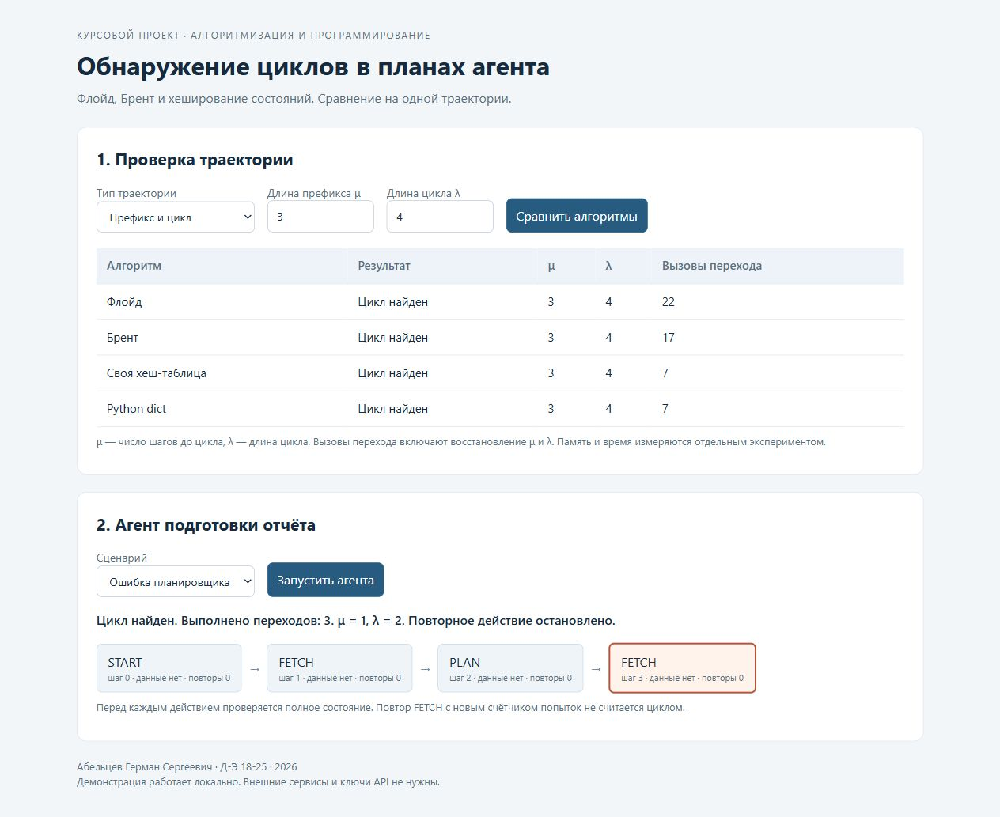

# Обнаружение зацикливания в планах агента

Курсовой проект по алгоритмизации и программированию. **Абельцев Герман Сергеевич**, группа Д-Э 18-25, РГАУ–МСХА имени К. А. Тимирязева. Руководитель — Калитвин Владимир Анатольевич.

Программа сравнивает алгоритмы Флойда, Брента, собственную хеш-таблицу и Python `dict`, а затем показывает остановку зациклившегося агента. Все вычисления выполняются локально.



## Запуск

Нужен **Python 3.10 или новее**. Сторонние библиотеки для программы не нужны.

1. Скачать проект: **Code → Download ZIP**, затем полностью распаковать.
2. В Windows открыть **Запустить программу.bat**.
3. Если браузер не открылся, перейти на http://127.0.0.1:8766.
4. Для остановки нажать Ctrl+C в окне программы.

Альтернатива для любой системы:

```sh
python -m cycle_project web
```

GitHub показывает и хранит исходники. Сам локальный сервер запускается на компьютере.

## Демонстрация за минуту

- Задать μ = 3, λ = 4. Все методы находят один цикл; вызовы перехода: **22 / 17 / 7 / 7**.
- Сценарий **loop**: цикл после трёх переходов, μ = 1, λ = 2.
- Сценарий **retry**: успешное завершение за восемь переходов, включая завершающий вызов.

## Где смотреть код

- [Флойд и Брент](cycle_project/algorithms.py) — поиск цикла и контроль бюджета.
- [Собственная хеш-таблица](cycle_project/hash_table.py) — хранение первых появлений и обработка коллизий.
- [Контроль агента](cycle_project/agent.py) — проверка перед следующим действием.
- [Тесты](tests) — 23 автоматические проверки.
- [Полные результаты](results) — контрольный пример, исходные замеры, сводка и условия эксперимента.

```sh
python -m unittest discover -s tests -v
python -m cycle_project compare --mu 3 --lam 4
python benchmark.py --out results_new --repeats 7
```

Для построения графиков отдельно установить `requirements-plots.txt`, затем запустить `plot_results.py`. Время на другом компьютере может отличаться. Флойд и Брент рассчитаны на чистую детерминированную модель; реальные действия контролируются за один проход. Постоянная память означает постоянное число состояний детектора, а не всей программы.

## Материалы защиты

[Курсовая, презентация, речь и инструкция к демонстрации](Материалы)

В каждом разделе есть PDF для просмотра и редактируемый Word либо PowerPoint. Презентация содержит 14 слайдов; речь — примерно 7–8 минут, отдельно предусмотрена короткая демонстрация.
